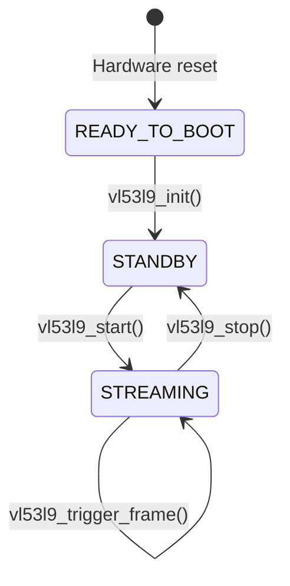

# VL53L9 Core Driver

The `vl53l9-core` module is a platform-agnostic, stateless driver that provides a lightweight interface to boot, configure and read data from a given VL53L9 sensor.

The host must implement the functions declared in `vl53l9_platform.h` to enable read/write operations through the control interface.
These functions also provide the hardware settings required to boot the sensor (VDDA, VDDIO, and external clock frequency).

The opaque `p_dev` pointer that is passed to most methods identifies a host-defined per-device context, which holds hardware-related details such as the bus handle and sensor address.
The driver passes it unchanged to the low-level platform functions without interpreting its contents.

To handle multiple sensors, the host must create a dedicated context for each device and then pass it to each driver call.
The same driver and platform functions can therefore serve multiple devices.

## Initialization

The `vl53l9_init()` function:
- makes sure that the device is in the `READY_TO_BOOT` state (requires that a hardware reset is performed by the host)
- writes boot-related registers with settings supplied by the host (VDDA, VDDIO, and external clock frequency)
- loads and boots the firmware patch
- applies the default configuration

## Configuration

### Resolution

Supported binning factors and corresponding output resolutions are:

| Binning factor | Output resolution |
| -------------- | ----------------- |
| 2              | 54 x 42           |
| 4              | 24 x 20           |
| 6              | 18 x 14           |
| 8              | 12 x 10           |
| 12             | 8 x 6             |
| 24             | 4 x 4             |

## Capture

The device enters the `STREAMING` state with the `vl53l9_start()` call.
The host can either configure the device to be notified of the completion of an acquisition through GPIO interrupt or I3C in-band interrupt or alternatively by polling the frame completion register through the `vl53l9_poll_frame()` function.

When the device is programmed to output data through CSI interface, data is sent asynchronously from the sensor to the CSI receiver, leaving the responsibility to the host to retrieve it.

When the device's output interface is set to I3C, the host can retrieve data in two ways:
- **Synchronously:** the host calls `vl53l9_get_frame()`. The call blocks until the frame is entirely read.
- **Asynchronously:** the data buffer is read in two steps. First, the host calls `vl53l9_get_frame_async()` to initiate the transfer of the first chunk. The function returns and the host waits for its completion. Then it calls `vl53l9_get_frame_async_ack()` with the same buffer and size. This call blocks while status and DSS (if enabled) are read.

Please note that certain binning factors disable some lines. However, despite being turned off, the I3C capture buffers include the disabled pixels when retrieving the data; we recommend using `vl53l9_get_raw_buffer_size()` to properly size your buffer.

The buffer is filled with depth, amplitude, ambient, optional DSS LUT indexes and status information. The buffer layout is shown below:

```text
+-----------------------------+
|           depth             |
+-----------------------------+
|           amplitude         |
+-----------------------------+
|           ambient           |
+-----------------------------+
|           [dss]             |
+-----------------------------+
|           status            |
+-----------------------------+
```

## Internal states

The following diagram summarizes the different device states and the driver calls that control their transitions:



## Known limitations

Binning is configured per context, but format and crop settings are shared.
`vl53l9_set_context()` does not restore these shared settings.

Workaround: always call `vl53l9_set_context()` first, then `vl53l9_set_binning()` for the selected context. Do not configure another context's binning afterward, as doing so overwrites the shared format and crop settings.
